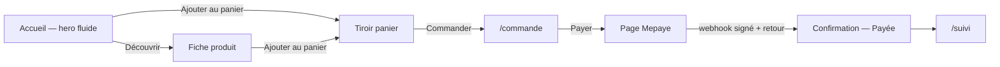

# 03 — App Flow : parcours de l'application

## Points d'entrée
- Accueil `/` (publicités TikTok/Instagram, recherche Google).
- Fiche produit `/robots/[slug]` (liens directs des publicités).
- Retour de paiement Mepaye → `/commande/confirmation`.
- Lien de suivi `/suivi` (e-mail de confirmation).
- Administration `/admin` (fondateur uniquement).

## Écrans
| Écran | À quoi il sert | Données nécessaires | User stories |
|---|---|---|---|
| Accueil `/` — hero fluide puis sections (confiance, anatomie, fonctionnement, gamme, cas d'usage, avis, FAQ, CTA final) | Séduire et orienter vers l'achat | Produits (nom, accroche, prix, scène, image détourée), disponibilité CJ | US1, US2, US8, US9 |
| Catalogue `/robots` | Comparer | Produits, tableau comparatif | US3 |
| Fiche `/robots/[slug]` | Convaincre et acheter | Produit, galerie, avis, délai CJ | US4 |
| Tiroir panier (toutes pages) | Ajuster rapidement | Panier localStorage | US2 |
| Panier `/panier` | Vérifier avant de payer | Panier, livraison | US2 |
| Commande `/commande` | Saisir l'adresse et payer | Panier, tarifs de livraison | US5 |
| Confirmation `/commande/confirmation` | Confirmer le paiement | Numéro de commande (navigateur), statut serveur | US5 |
| Suivi `/suivi` | Suivre le colis | Numéro + e-mail | US6 |
| Admin connexion / commandes / fiche commande / fournisseur | Gérer | Commandes, événements, commandes CJ, solde CJ | US7 |
| FAQ, contact, livraison-retours, pages légales, 404 | Informer | Contenu statique | — |

## Parcours principal

## Parcours alternatifs
- **Annuler** : fermer le tiroir panier (Échap, clic à côté, bouton) ; quitter Mepaye sans payer → la confirmation propose de reprendre le paiement, la commande reste « En attente de paiement ».
- **Modifier** : quantités dans le tiroir ou sur `/panier` (1 à `MAX_QUANTITY`) ; changer de robot dans le hero (vignettes / points).
- **Revenir** : lien retour du tunnel vers le panier ; bouton retour du navigateur conservé (le hero reprend au robot 1).
- **Passer** : le hero peut être sauté par le lien « Voir les robots » ou en faisant défiler.

## Actions, avec tous leurs états
| Action | Déclencheur | Validation | Chargement | Réussite | Erreur | Écran suivant |
|---|---|---|---|---|---|---|
| Changer de robot dans le hero | Minuteur ~6 s, clic sur un point/vignette, flèches clavier | — | Image suivante préchargée ; fondu 0,9 s | Scène, nom, accroche et prix du robot affichés | Image absente → fond neutre + robot détouré | Hero |
| Ajouter au panier (hero, carte, fiche) | Clic CTA | Robot disponible | Bouton désactivé le temps de l'ajout | Tiroir ouvert, compteur à jour, Lenis arrêté | Rupture → « Indisponible », bouton inactif | Tiroir |
| Commander | Formulaire `/commande` | Serveur : champs, prix, stock, livraison | « Redirection vers le paiement… » | Redirection Mepaye | Message générique + champs en erreur ; paiement indisponible → message dédié | Mepaye |
| Confirmation de paiement | Retour Mepaye | Statut lu côté serveur | « Paiement en cours de confirmation… » (nouvel essai périodique) | Récapitulatif, panier vidé | Non payé → bouton « Reprendre le paiement » | Confirmation |
| Suivre une commande | Formulaire `/suivi` | Numéro + e-mail correspondants | Bouton en chargement | Statut, historique visible, lien transporteur | « Commande introuvable » générique | Suivi |
| Connexion admin | Formulaire | Mot de passe côté serveur | Chargement | Tableau de bord | « Mot de passe incorrect » | Admin |
| Transmettre à CJ / Actualiser | Bouton fiche commande | Session admin | Chargement | Carte fournisseur à jour | Erreur CJ affichée en rouge, nouvel essai automatique | Fiche commande |

## Navigation
- **Menu** : en-tête discret (logo Clair, Robots, Suivi, panier) ; menu plein écran sur mobile (Lenis arrêté pendant l'ouverture).
- **Bouton retour** : comportement natif ; défilement remis en haut au changement de page (`lenis.scrollTo(0, { immediate: true })`).
- **Liens profonds** : `/robots/q3`, `/robots/s2`, `/robots/o1`, ancres `/#fonctionnement` (via Lenis, décalage de l'en-tête).

## États vides ou bloqués
- **Aucune donnée** : panier vide → message + lien vers `/robots` ; CJ injoignable → délais par défaut.
- **Permission refusée** : `/admin` sans session → redirection vers la connexion.
- **Hors ligne** : message du navigateur ; le panier reste en localStorage.
- **Mouvement réduit** : hero figé sur le robot 1 avec navigation manuelle, pas de Lenis.

## Première utilisation
- **Accueil (onboarding)** : sans objet, le hero sert d'introduction.
- **Création de compte** : sans objet (pas de compte client).

## Questions tranchées
> Toutes tranchées par l’utilisateur le 2026-10-31.
- Le CTA principal du hero ajoute-t-il au panier ou mène-t-il à la fiche ? → **tranché** : « Ajouter au panier » + lien secondaire « Découvrir le Q3 ».

## Historique
| Version | Date | Changement | Validé par |
|---|---|---|---|
| 0.1 | 2026-10-31 | Création | — |
| 1.0 | 2026-10-31 | Questions tranchées, passage en finalisé | shadowmartin281 |
