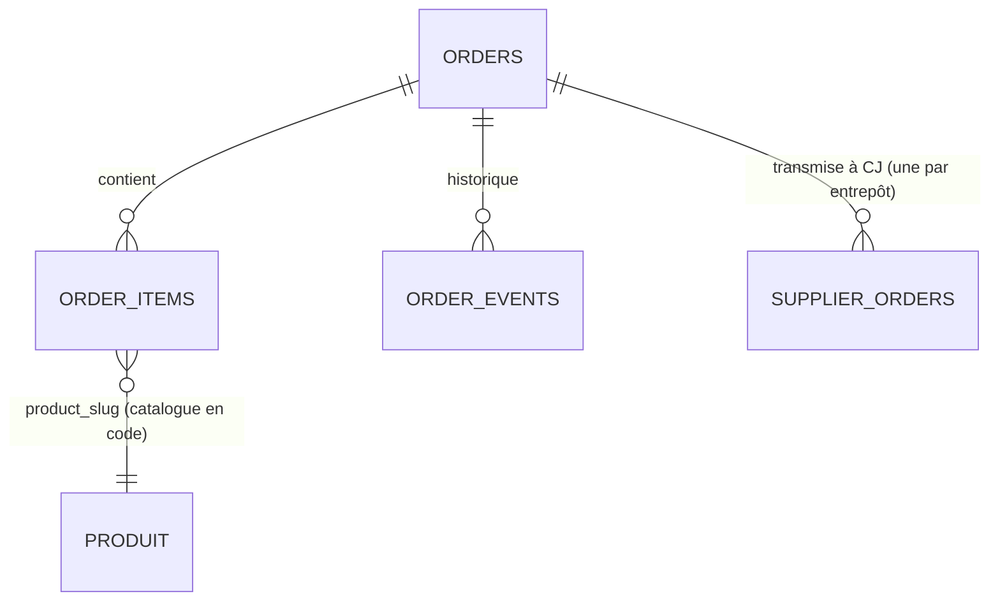

# 05 — Schéma backend

> Décrit le schéma **déjà en place** (`web/src/db/schema.ts`, migrations Drizzle dans `web/drizzle/`). Le hero fluide et Lenis n'ajoutent aucune table. Montants en centimes d'euro TTC, dates en millisecondes.

## Entités
| Entité | Ce qu'elle représente |
|---|---|
| Produit | Un robot du catalogue (Q3, S2, O1). **Pas en base** : défini dans `src/lib/products.ts`, enrichi par CJ (prix d'achat, stock, délais) |
| Commande (`orders`) | Un achat client, de la création au paiement puis à la livraison |
| Ligne de commande (`order_items`) | Un robot et sa quantité dans une commande, prix figé au moment de l'achat |
| Événement (`order_events`) | Historique : statut, suivi, note interne, échange fournisseur |
| Commande fournisseur (`supplier_orders`) | La commande passée chez CJ, une par entrepôt d'expédition |

## Tables ou collections
### orders
| Champ | Type | Obligatoire | Valeur par défaut | Index |
|---|---|---|---|---|
| id | integer, clé primaire auto | oui | — | oui |
| number | text (CL-123456) | oui | — | unique |
| status | text : en attente de paiement, payée, en préparation, expédiée, livrée, annulée, remboursée (`ORDER_STATUSES`) | oui | — | oui |
| email, first_name, last_name, phone | text | oui | — | email : oui |
| address1, postal_code, city | text | oui | — | non |
| address2 | text | oui | "" | non |
| country | text | oui | "FR" | non |
| newsletter | booléen | oui | false | non |
| shipping_method | text (standard, express) | oui | — | non |
| shipping_label | text | oui | — | non |
| shipping_price, delivery_min_days, delivery_max_days | integer | oui | — | non |
| subtotal, vat, total | integer (centimes) | oui | — | non |
| payment_provider, payment_reference, carrier, tracking_number | text | non | — | non |
| created_at, updated_at | timestamp ms | oui | — | non |
| paid_at, shipped_at, delivered_at | timestamp ms | non | — | non |

### order_items
| Champ | Type | Obligatoire | Valeur par défaut | Index |
|---|---|---|---|---|
| id | integer, clé primaire | oui | — | oui |
| order_id | integer → orders.id (suppression en cascade) | oui | — | oui |
| product_slug, product_name, cj_sku, cj_vid | text | oui | — | non |
| unit_price, quantity, total | integer | oui | — | non |

### order_events
| Champ | Type | Obligatoire | Valeur par défaut | Index |
|---|---|---|---|---|
| id | integer, clé primaire | oui | — | oui |
| order_id | integer → orders.id (cascade) | oui | — | oui |
| type | text (status, tracking, note, supplier) | oui | — | non |
| status | text (`ORDER_STATUSES`) | non | — | non |
| message | text | oui | — | non |
| visible_to_customer | booléen | oui | — | non |
| created_at | timestamp ms | oui | — | non |

### supplier_orders
| Champ | Type | Obligatoire | Valeur par défaut | Index |
|---|---|---|---|---|
| id | integer, clé primaire | oui | — | oui |
| order_id | integer → orders.id (cascade) | oui | — | unique avec from_country |
| from_country | text (code ISO de l'entrepôt) | oui | — | unique avec order_id |
| reference | text (CL-123456, préfixe TEST- en sandbox) | oui | — | non |
| logistic_name, cj_order_id, cj_status, track_number, tracking_url, error | text | non | — | non |
| sandbox | booléen | oui | — | non |
| state | text (sending, sent, unpaid, shipped, delivered, cancelled, error) | oui | — | non |
| attempts | integer | oui | 0 | non |
| amount_usd_cents | integer | non | — | non |
| created_at, updated_at | timestamp ms | oui | — | non |
| synced_at | timestamp ms | non | — | non |

## Relations

## Propriété des données
- Toutes les données appartiennent à la boutique (l'administrateur). Un client n'accède qu'à sa propre commande, et seulement avec le couple numéro + e-mail, en lecture.

## Authentification
- **Inscription / connexion / réinitialisation** : pas de compte client. Administrateur : mot de passe unique (`ADMIN_PASSWORD`), changé dans les variables d'environnement.
- **Durée de session** : session admin signée (`ADMIN_SESSION_SECRET`), cookie HttpOnly, Secure, SameSite=Lax (proposition : 7 jours).

## Droits d'accès
| Entité | Lire | Créer | Modifier | Supprimer |
|---|---|---|---|---|
| orders | Admin ; client (sa commande, numéro + e-mail, champs limités) | Serveur (action commande) | Admin ; serveur (webhook, synchro CJ) | Personne (annulation par statut) |
| order_items | Admin ; client (sa commande) | Serveur | Personne | Cascade seulement |
| order_events | Admin ; client (événements `visible_to_customer`) | Serveur, admin (notes) | Personne | Cascade seulement |
| supplier_orders | Admin | Serveur | Serveur (synchro), admin (actions) | Cascade seulement |

Seul le serveur accède à la base (aucune requête depuis le navigateur) : SEC-3 est respectée par construction.

## Validation des données
- Côté serveur uniquement (SEC-5) : champs du formulaire (longueurs, e-mail, téléphone, code postal français), prix recalculés depuis `lib/products.ts`, quantités 1 à `MAX_QUANTITY`, stock CJ, mode de livraison autorisé.
- Webhook Mepaye : signature, montant, devise EUR, clé test ou réelle cohérente, rejeu sans effet.
- Unicité : `orders.number`, couple (`order_id`, `from_country`) des commandes fournisseur.

## Conservation et suppression
- Commandes et lignes conservées 10 ans (obligation comptable), ensuite anonymisées (proposition).
- Données de prospects (commandes jamais payées) supprimées après 90 jours (proposition).
- Exportables sur demande du client (RGPD) depuis l'administration (à prévoir, P3).

## Migrations et données initiales
- Migrations Drizzle (`npm run db:generate`), appliquées automatiquement au démarrage et au premier accès en production.
- Pas de données initiales : le catalogue est dans le code.

## Questions tranchées
> Toutes tranchées par l’utilisateur le 2026-10-31.
- Durées de conservation → **tranché** : 10 ans pour les commandes payées, 90 jours pour les commandes jamais payées.
- Durée de la session admin → **tranché** : 7 jours.

## Historique
| Version | Date | Changement | Validé par |
|---|---|---|---|
| 0.1 | 2026-10-31 | Création (rétro-documentation) | — |
| 1.0 | 2026-10-31 | Questions tranchées, passage en finalisé | shadowmartin281 |
